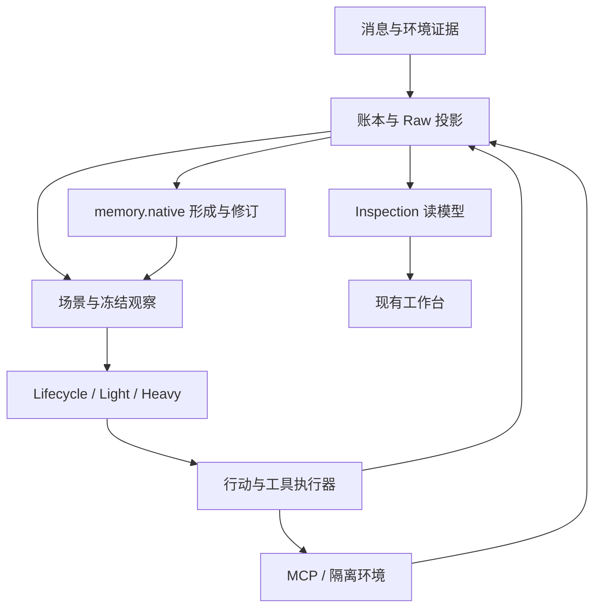

# 持续 Agent 实施与验收台账

本页承接 [#279](https://github.com/posanbu/Kaguya/issues/279)。采用 `memory.native` 与 Kaguya runtime，按 W0–W12 推进公共契约、Memory/行动、工具与环境、检视、贯穿验收和部署。全计划已获执行授权；实现、CI、真实模型、部署和用户验收分别记账。

**核对基线** — 2026-10-24，GitHub main 为 [`7edca245`](https://github.com/posanbu/Kaguya/tree/7edca245e382653765f7e7519d6e59323a460efb)。已读取 #279 正文及全部两条评论，#247–#250、#178、#192、#193 的正文/评论及下列关联 PR。“已有”指 main 有代码，“历史验证”指关联 PR 曾记录结果，“待验收”指本计划尚缺对应证据。

**协作方式** — 主协调分发、审查和验收，implementation session 实施。全程复用唯一普通 checkout，同一时刻一个 writer；未获写入权的 session 只读，不切分支、安装、构建或运行会写产物的测试。交接提供 SHA、文件、验收映射、实际命令结果、迁移/回退、剩余事项，并明确释放写入权。

## 已批准的路线

这是目标职责图。通用执行器、MCP、环境租约和完整经历修订仍待实现验收。

**职责** — Kaguya 拥有事实、身份/scene/scope、冻结截止点、独立消费进度、Memory 发布和行动有效性。`agent.lifecycle` 统一节拍、活动、睡眠与观察调度；Light 判断参与，Heavy 表达并运行工具循环。执行器校验权限/依赖，适配器声明取消、幂等和核对能力，环境服务拥有进程、工作区、浏览器/桌面、租约与产物。注册能力和取得资源使用权分别确认。

**Memory** — 继续完善现有统一 native 图、事务发布、固定摘要与混合召回，保留原文/关键词基线。本轮不开展十个后端选型，不恢复旧 cognition、Mem0、Raw 或 Expression 模块。原始账本、Raw 投影、来源 ID、`memory_native_epoch`、修订历史、scope/权限与冻结截止点均保留；向量作为可重建投影。形成事件继续使用 `memory.native.formation.requested.v1` 及固定订阅身份，不增加兼容分支。

**DSH** — 参考工具注册、上下文、MCP、运行轨迹和环境设计，保留已有共享纯协议包。独立组件复用须固定包/版本、许可证、依赖、生命周期与兼容测试；暂缓整体 runtime 迁移和双端插件同步发布，保留 #286–#288 的成果及状态。已有 [DSH 对照](../developers/situation-model/dsh-cognition)是历史基线资料，本轮未重新认证外部版本。后续有明确维护收益及可重放对照时，再提复用/迁移决定。

## 当前证据与差距

**公共契约** — [#285](https://github.com/posanbu/Kaguya/pull/285)、[#289](https://github.com/posanbu/Kaguya/pull/289) 提供模型契约与共享校验；[#290](https://github.com/posanbu/Kaguya/pull/290) 接通冻结情境、原生返回和 `/situation`。对应 `situation-runtime.ts`、`situation-model.ts`、`native-input.ts`、`inspection-situation.ts`。这不等于全部消费者已采用统一独立进度。

**观察端口** — #247 打开；[PR #255](https://github.com/posanbu/Kaguya/pull/255) 仍未合入，head `ac292582d10681b810ed561d18ad48e8cc4aa47e`。W1 先与当前 main 对照再复用；默认运行链接线、defer/替代、回填及领域 DTO 仍需验收，旧 PR 的验证不代表新 head 通过。

**Memory** — [#283](https://github.com/posanbu/Kaguya/pull/283) 提供图与管理；[#291](https://github.com/posanbu/Kaguya/pull/291) 提供统一形成、预期版本发布、锁定、范围过滤和冻结；[#295](https://github.com/posanbu/Kaguya/pull/295) 增加人物证据与 Heavy 持久补查。入口为 `packages/database/src/native-memory.ts`、`packages/memory/src/native.ts`、`first-party/memory-native`、`first-party/heavy/recall.ts`。完整经历及来源失效仍由 #248 验收；其最新评论已撤销 Expression 独立进度等旧假设。

**模块校准** — [#192](https://github.com/posanbu/Kaguya/issues/192) 已按方案替代关闭，保持关闭。[#296](https://github.com/posanbu/Kaguya/pull/296) 已合入唯一公开模块 `agent.lifecycle`；#193 的旧短心跳正文及 #178 的旧切片列表须据此更新，草稿见[实施 issue](./issue279-issues)。

**行动** — #290 已分离 delivery 开始与回执，未知发送不自动重发；[#293](https://github.com/posanbu/Kaguya/pull/293) 已有逐段表达、持久停顿和回执后接续。专用 recall 和原生历史配对检查可复用，通用工具循环、停止/更正干预、恢复时效性和取消竞争仍待验收。

**验证口径** — #291/#295 有历史本地完整回归，#296 首轮全量失败后仅复测相关套件；#295 的形成失败及缺少实际 Heavy 补查样本保留原记录。本轮未重跑 main 业务测试，这些记录不替代 W11。

## 九项原交付

- **D1 架构职责图 → W0/W1/W3** — 图与保留 runtime 路线已形成；以唯一状态拥有者及事实→冻结→执行→结果的实现路径验收，待验收。
- **D2 钩子/能力对照 → W1/W3/W4/W5/W6** — 已有模块生命周期与持久任务；七个时机的输入输出、等待、错误、取消、恢复和版本映射待验收，见 W1。
- **D3 DSH 决策 → W0** — 参考、条件式独立复用、整体迁移及双端发布暂缓已由主协调确认；采用组件另附版本/许可证/兼容证据。
- **D4 Memory 决策 → W0/W2** — 简化为完善 native，保留证据与图/索引职责；路线已由主协调确认，修订、新鲜读取和失效传播待 W2 验收。
- **D5 Memory 可视化 → W2/W9/W10** — 现有图、历史与冻结视图可复用；经历正文、逐项来源、修订差异、关系、召回和滞后待贯穿验收；更正走发布接口。
- **D6 Tools/MCP 接口 → W3/W4/W5** — 专用 recall 已有；统一发现/权限、主动与自动使用、长任务、两种 transport、tools/resources/prompts 和结果恢复待验收。
- **D7 Computer Use 环境 → W6/W7/W8/W12** — 首版为 Linux rootless Podman，分别验证 shell、Chromium DOM/CDP、隔离 GUI/视觉、租约、产物与接管，均待验收；VM/其他平台另议。
- **D8 代表性原型/重放 → W11** — 既有局部回归不替代本计划贯穿结果；多人案例、真实 PostgreSQL、浏览器、GUI、模型效果与开销待分层验收。
- **D9 设计记录与实施拆分 → W0–W12** — 台账已由主协调审查，实施 issue 已分发，#193 正文调整待有权限维护者发布；实现交付逐包补入实际 SHA/PR/CI/迁移/部署证据，计划本身不计功能完成。

## 工作包台账

Sol 指 `gpt-6.1-sol`，Astra 指 `gpt-6-astra`。依赖规定技术顺序，所有写入仍逐包派发。每包沿用下文公共验收、迁移和发布要求。

### W0 基线与交付台账

**Owner / 依赖 / issue** — Sol；无代码前置；#279。

**验收与状态** — 核对基线、九项交付、路线与实施映射，完成文档检查、本地提交及主协调审查。原分支 `feat/memory-graph-management` 的 `2395dcf6` 是已 squash 合入 #283 的 head，保留原分支；同一 checkout 已安全切至更新 main，再建立单个短期 W0 分支。台账内容已由主协调审查，本轮交付范围为文档及 GitHub 分发，不进行功能开发、模型调用或部署。上游账号无 push/triage 权限；采用已获授权的同账号远端 fork 提 PR，唯一 checkout 与原 origin 保留。

### W1 公共契约与持久观察

**Owner / 依赖 / issue** — Astra；W0；#247，审查承接开放 #255。

**验收与状态** — scene/scope、冻结清单、独立进度、迟到/分页、defer/替代及双 worker 恢复。冻结 a/b 后 c 只进后继观察，失败不越水位，提交边界有持久断言。持久接纳、冻结、模型决策前、执行前、结果接纳、后台发布、插件启停七个时机逐一说明输入输出、观察/修改权、等待/顺序/预算、错误/取消/幂等/恢复/版本。main 已有情境冻结，完整 #247 待验收。

### W2 native Memory 修订

**Owner / 依赖 / issue** — Astra；W1；#248，复用 #265 已完成底座。

**验收与状态** — 封口/重开/合并/拆分、第 33 条后与迟到更正、撤回/身份拆分失效闭包、版本冲突后继操作；验证静默形成、新证据可读、旧冻结不读未来版本及空结果/失败。#291/#295 提供基础，以上完整行为待验收；保留 epoch、锁定与修订，不复活旧 writer。

### W3 行动执行与恢复

**Owner / 依赖 / issue** — Astra；W1，Memory 接线与 W2 协调；#249。

**验收与状态** — 消息和可控工具共用 decision/intent/result，执行前校验授权、依赖、时效；更正/停止使未执行意图失效，无关插话保留工作，dispatch/取消只有一个有效胜者。覆盖旧正文、接续和延迟任务重启恢复，unknown 先核对。已有 delivery 与逐段链，增量行为待验收。

### W4 Heavy 原生工具循环

**Owner / 依赖 / issue** — Astra；W3，Memory 工具接 W2；[#299](https://github.com/posanbu/Kaguya/issues/299)。

**验收与状态** — 原生工具声明/call/result、持久 call ID、usage、长任务、多步/并行/有序、预算、取消/重启及不支持分支。Memory 查询/阅读/更正/经历回看复用范围接口，历史裁剪保留完整配对。现有专用 recall/原生历史可复用，通用循环及真实协议效果待验收。

### W5 MCP 接入

**Owner / 依赖 / issue** — Sol；W3/W4；[#300](https://github.com/posanbu/Kaguya/issues/300)。

**验收与状态** — stdio、Streamable HTTP 的 tools/resources/prompts，含发现/分页、认证引用、连接/进程、取消/重连/卸载。内容保留来源、scope 和预算；错误及 unknown 回写同一行动链，重连不盲重发。resources 首版按需 list/templates/read；resource subscriptions、elicitation、MCP tasks、自动 OAuth 授权暂缓，对外 MCP 服务端另议。待实现验收。

### W6 rootless Podman 环境与租约

**Owner / 依赖 / issue** — Astra；W3；[拟建环境 issue](./issue279-issues#w6-隔离环境与租约)。

**验收与状态** — 执行账户、环境/工作区归属、显式挂载/网络/凭据、持久目录、完整观察—操作—核对租约与 fencing、产物/接管。验证两 worker、过期持有者、失联/重启；取消保留产物。安装、隔离及恢复均待验收；管理员步骤由用户在 Linux 执行。

### W7 shell 与 Chromium

**Owner / 依赖 / issue** — Sol；W5/W6（W4 经 W5 传递）；[拟建执行 issue](./issue279-issues#w7-shell-与-chromium)。

**验收与状态** — 隔离环境实跑 shell 和 Chromium DOM/CDP，核对输出/退出码、页面/表单、下载与产物；覆盖超时、取消、重连、profile/工作区归属与租约。进程退出或页面加载不单独计任务成功。待实现验收。

### W8 隔离 GUI 与视觉

**Owner / 依赖 / issue** — Astra；W5/W6，仅共用浏览器场景依赖 W7；[#303](https://github.com/posanbu/Kaguya/issues/303)。

**验收与状态** — 隔离桌面、真实截图/图像输入、坐标/键盘、画面时效、连续租约和用户接管；以合成应用前后状态核对副作用。环境变化/接管使旧操作失效。视觉模型待能力探测，完整链待验收；文本替身不计视觉成功，受阻交主协调决定。

### W9 Inspection 读模型

**Owner / 依赖 / issue** — Astra；W1–W6，W7/W8 投影随后补齐；#250/#178/#193。

**验收与状态** — 受认证/脱敏 DTO 关联观察/进度、revision/provenance、行动/工具、环境 lease/产物及 Lifecycle。保留截止点、分页、来源缺失、滞后与 unknown，历史不冒充当前状态。已有情境/模块检查 API，跨领域增量待验收；#193 改按 Lifecycle 活动/睡眠/观察/调度追溯保留 Kind。

### W10 现有工作台 UI

**Owner / 依赖 / issue** — Sol；W9 及对应领域实现；#250/#178/#193。

**验收与状态** — 扩展现有情境、Memory 与模块页，回答输入/进度/结果/来源；列表→详情→返回保留筛选、选择、焦点。验证桌面/窄屏、401、空态/错误/截断/长字段、取消与晚到响应。已有局部页面，增量待验收；不以此批准前端框架迁移。

### W11 贯穿验收

**Owner / 依赖 / issue** — Sol；W1–W10；#250，质量记录关联 #197/#278。

**验收与状态** — 执行下节多人案例与故障矩阵，分别交付确定性回放、真实 PostgreSQL、浏览器/GUI、获配额模型和当前 head CI。持久化/并发覆盖 Ubuntu/macOS/Windows 与 PostgreSQL。完整结果待形成；加速回放与真实持续运行分别报告。

### W12 迁移、部署与回退

**Owner / 依赖 / issue** — Sol 实施、Astra 审查；W11 及用户执行管理员脚本；[拟建部署 issue](./issue279-issues#w12-linux-部署)。

**验收与状态** — 备份/验证数据库和配置恢复点，审查增量迁移与 epoch，按获验收 main SHA 部署；核对 Runtime/PostgreSQL、模型/工具/环境/页面、重启及回退。主协调提供的生产快照是 `60b952a`、Kaguya/PostgreSQL active，本 session 未连服务器复核，新代码部署待验收。NapCat 由用户手动启动，不接管或重建登录。

## 公共验收与交接门槛

**贯穿案例** — 虚构 A 提议周六活动，B 表示值班，C 插话；Agent 静默时 Memory 仍登记。B 后来更正已调班，天气工具带来源返回；形成滞后时新观察显示旧经历和未纳入更正。Heavy 使用原生/MCP 工具，分别在规划、生成、排队、执行时注入停止、更正及无关消息，检查实际行为、修订和来源。

**故障与断言** — 覆盖提交前后/广播前崩溃、迟到/同时间/分页、重复投递、双 worker、版本冲突、索引/投影滞后、回执丢失、服务/环境失联、截图过期与租约接管。区分提议、草稿、尝试、成功、失败、取消请求/确认、部分完成和 unknown；第 33 条后更正、旁支归属、撤回/身份拆分、旧冻结不读未来版本均有行为断言。

**等待策略** — 检查整个相关 fixture 的就绪、行为、收敛和清理等待，优先持久完成信号或有界条件轮询，沿用当前 helper 预算，业务 deadline 单独保持。轮询只观察，失败释放阻塞；固定 sleep、短默认等待、放宽断言、跳过平台与不断重跑不能替代原因修复。

**证据分层** — 绑定 SHA、策略/Schema、合成样例哈希、命令结果和必要 trace/截图；确定性模型、PGlite、真实 PostgreSQL、协议、浏览器、视觉模型及部署分别报告。记录实际效果、调用数/token、延迟和运维开销，未知用量保持未知。

**模型预算** — 全计划所有 session 在已授权 USTC 服务累计最多 30 次请求且最多 100,000 输入 token，能力探测和重试均计入。主协调统一分配配额；请求前估算，可能超过剩余额度则不发起，各 session 读取 prompt caching 规则后才调用。输入限虚构案例、Schema、测试页面/截图，不含私聊、真实群聊、凭据和私人文件。W0 不调用模型。

**发布** — 主协调已核对 active main ruleset `19726886`：要求 PR、至少一个 approving review、所有 review threads resolved、linear history，允许 squash/rebase。required status checks 列表为空不代表允许直推；不强推或绕过。推送后核对实际最新 head 的 CI 与 review，新增提交重新核对。按当前 workflow 完成文档/质量/关键分片/聚合/路由检查，持久化与并发另验三平台和 PostgreSQL；pending、failed、skipped、未触发分别保留。

**迁移/回退** — 每包列出新增结构/Kind、启用/退出、兼容读取、备份、幂等步骤和回填水位；不静默合并 scope 或复活旧 writer。回退先停新领取、排空在途工作、核对 unknown 并释放/隔离租约；保留事实、epoch、修订、产物和日志，确认旧程序与现有 Schema/Kind 兼容后再退程序/配置。恢复数据库另核对恢复点之后的证据与外部副作用。

**Linux 前置** — 主协调快照为 Ubuntu 26.04 x86_64、32 GB RAM、约 801 GB 空闲，无 Podman/Docker、Chromium、Xvfb/KVM，`sudo -n` 不可用。本轮未远端复测。W6/W12 复核包/权限/资源，准备并审查一份幂等管理员安装脚本，由用户亲自在 Linux 执行；用户桌面、私人账号及 NapCat 不作验收环境。

**交付格式** — 各包补入实际 SHA/PR、文件、D/W 验收映射、命令及结果、本地/最新 head CI/review、迁移/回退、剩余事项与写入权释放。后续 issue 映射与紧凑正文草稿见[实施 issue](./issue279-issues)。
